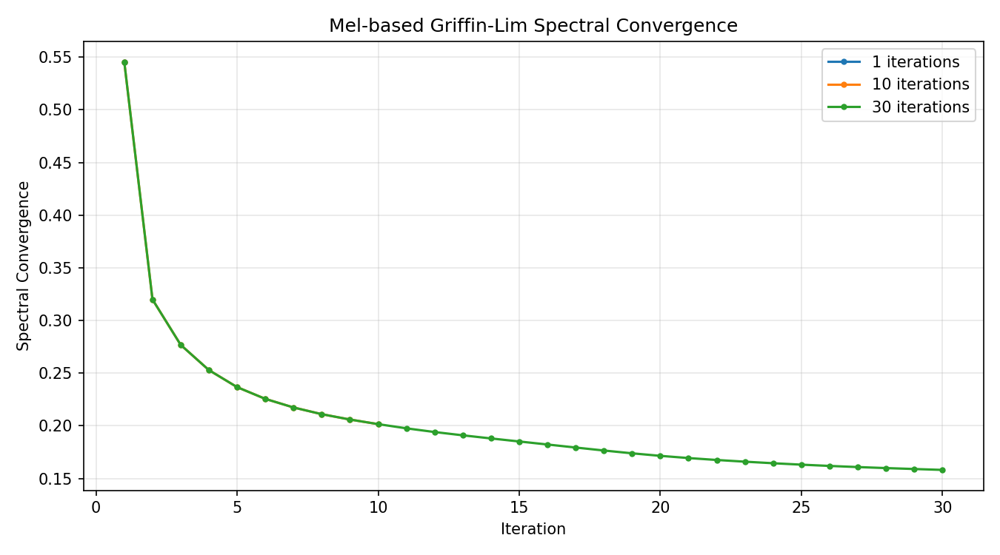

# VoiceLab Project Report — 2025AE05387

**Configuration:** 10 words; 4 spoken sentences; 16 kHz; 25 ms frame; 8 ms hop; Hamming window; 32 mel filters; 13 MFCCs; 3-state HMM; held-out repetition 1; 5 training iterations; noise SNR 10/0 dB; beam widths 1/8; Whisper base.

This report is based on saved notebook outputs and project artifacts. The run_all.sh execution completed successfully in Colab. Part 5 composition and own-sentence decoding retain the verification caveat documented below.

## Part 0 — Dataset and audit

The archive contains 30 word clips, four sentence clips, original recording blocks, room noise and noisy clips. The saved audit reports 0% clipping for sentence clips; goat\_1.wav and goat\_2.wav each show approximately 3.3% clipping and should be checked.

## Part 1 — Signal analysis and features

The notebook includes waveform/spectrogram analysis, wideband/narrowband comparison, NumPy/SciPy MFCC compared with Librosa, and autocorrelation F0 compared with pYIN. The saved MFCC example is 60×13 for cab\_0.wav, with differences around 10^-7. Multiple F0 result files are retained; their estimates should be interpreted using the notebook's final/verified outputs rather than treating the files as interchangeable.

## Part 2 — HMM

Diagonal-Gaussian log emissions, Forward/Viterbi and segmental K-means are implemented. Held-out accuracy is 9/10 (90%); think was classified as sink. Toy Forward and Viterbi checks are in results.json.

## Part 3 — CTC

CTC forward recursion is implemented in log space with blank expansion and the repeated-label transition restriction. The saved toy probability is 0.3073; the NumPy/PyTorch CTCLoss comparison is approximately 0.307300 versus 0.30729994. CTC uses a monotonic frame-to-label alignment with blank symbols and sums valid paths; RNN-T additionally models output-label history jointly with encoder time, while attention-based encoder-decoder models generate output tokens using an attention distribution over encoder states. These alternatives differ in alignment assumptions and decoding behaviour.

## Part 4 — Language model and lexicon

Brown corpus evaluation uses 51,147 training sentences, 24,718 vocabulary items, four held-out sentences, five OOV tokens mapped to <UNK>, and minimum count 2. Saved perplexities: add-one 3522.3225; interpolated Kneser–Ney 638.2692. CMUdict, G2P fallback and three personal pronunciation alternatives are present.

## Part 5 — WFST

The toy lexicon has 10 states, determinises to 7 and minimises to 5. The notebook contains three toy phone-to-word paths and L∘G composition for two sentences. The saved design log retains a clean-kernel verification caveat for composition and own-sentence decoding; therefore, these outputs are reported as notebook evidence, not as independently confirmed fresh-runtime results.

## Part 6 — Recognisers, Search and Decoding

Whisper and wav2vec2 were evaluated using four spoken sentences under clean, 10 dB and 0 dB noise conditions. The custom Word Error Rate (WER) implementation was validated against `jiwer` on four Whisper clean-condition examples.

The average WER results were:

| Condition | Whisper WER | wav2vec2 WER |
|---|---:|---:|
| Clean | 0.3978 | 0.4276 |
| 10 dB | 0.4291 | 0.7798 |
| 0 dB | 0.5084 | 0.9489 |

Whisper achieved lower WER than wav2vec2 under all three conditions. Both systems experienced performance degradation as noise increased, with wav2vec2 showing substantially greater sensitivity to noise.

Error analysis showed that substitutions were the dominant error type. At 0 dB, Whisper recorded 18 total errors, whereas wav2vec2 recorded 33.

CTC prefix beam search with language-model fusion was evaluated using beam widths 1 and 8. Sentences 1–2 were used for tuning, while sentences 3–4 were held out. All tested language-model weights produced a tuning WER of 0.4107; therefore, alpha = 0.0 was selected. The held-out WER remained 0.4444, equal to the baseline, indicating no measurable benefit from language-model fusion.

Average decoding time increased from 19.19 ms at beam width 1 to 174.86 ms at beam width 8, approximately 9.11 times slower. Thus, the wider beam increased computational cost without improving the observed held-out WER.

## Part 7 — Synthesis

The notebook includes STFT/ISTFT reconstruction and a custom Griffin–Lim implementation. For Mel-based reconstruction, the Mel filterbank was inverted using its pseudo-inverse to estimate a linear-frequency power/magnitude representation. Griffin–Lim was evaluated at 1, 10 and 30 iterations. Spectral convergence decreased from 0.545613 (1 iteration) to 0.201625 (10 iterations) and 0.158171 (30 iterations), showing progressive convergence. The 30-iteration value is also recorded in `results.json` as 0.1581709213.

*Figure: Mel-based Griffin–Lim spectral convergence for 1, 10 and 30 iterations.*

### Text normalisation

A rule-based written-to-spoken normaliser converts numeric expressions, currency notation, abbreviations and hyphenated digit sequences into spoken forms. It was evaluated against the four configured spoken references and achieved 4/4 exact matches (100%). The tested rules included `4` → “four”, `Rs. 45` → “forty five rupees”, `Wed.` → “Wednesday”, and `293-902` → “two nine three nine zero two”. This result applies to the four selected sentences and does not establish coverage of every possible number, currency or abbreviation format.

This written-to-spoken evaluation is distinct from the Part 6 ASR exact-match evaluation; the two metrics should not be conflated.

### Neural TTS and comparison

The configured Tacotron2-WaveRNN pipeline generated four outputs at 22,050 Hz. Their recorded durations were approximately 3.455, 3.467, 3.592 and 3.704 seconds. Subjective listening found all four outputs intelligible and complete, with no noticeable mispronunciations or unusual pauses; the voice sounded reasonably natural.

The 30-iteration Griffin–Lim reconstruction achieved a STOI score of 0.9204 against the original recording. A direct STOI score was not reported for the independently generated Neural TTS outputs because their timing and prosody differ from the reference recording; truncating them to equal length would not establish valid temporal alignment. The synthesis methods are therefore compared using the objective Griffin–Lim STOI result and the listening-based assessment of Neural TTS, rather than presenting incomparable scores as if they were measured on aligned signals.

STOI estimates short-time objective intelligibility, but does not fully measure naturalness, speaker similarity, emotion or prosody. Subjective listening complements the objective score.

## Findings

The only HMM held-out error is think→sink. Kneser–Ney perplexity is lower than add-one. Wav2vec2 recognition degrades as SNR decreases. The saved LM-weight sweep is flat and shows no measurable held-out gain. STOI is lower at 0 dB than at 10 dB.

The rule-based written-to-spoken text normaliser was implemented to convert numeric expressions, currency notation, abbreviations and hyphenated digit sequences into their spoken forms. The implementation was evaluated against all four personal spoken sentences.

All four normalised outputs matched their corresponding spoken references exactly, achieving an exact-match accuracy of 100% (4/4).
The rules successfully handled:
- Numeric conversion, including 4 and 9.
- Currency expansion and placement: Rs. 45 → forty five rupees.
- Abbreviation expansion: Wed. → Wednesday.
- Digit-by-digit conversion of hyphenated access codes: 293-902 → two nine three nine zero two.

No mismatches were observed in the four evaluation sentences. However, this result demonstrates performance on the selected sentences and does not establish coverage of every possible number, currency or abbreviation format.

## Submission readiness
The project contains the notebook, configuration, saved experimental outputs, report source, design log, AI-use statement and execution script. The saved results include all ten required results.json keys. The run_all.sh execution completed successfully in Colab. Part 5 WFST composition and own-sentence decoding retain a clean-kernel verification caveat in the design log and are not claimed as independently verified. The final PDF is generated from this Markdown report and checked against the four-page assignment limit.
